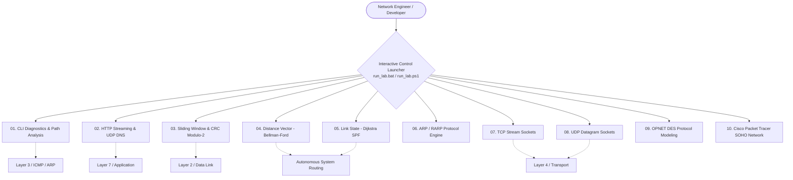

# 🌐 Networks-Commands-Deeply
### The Comprehensive Engineering Guide to Network Diagnostics, CLI Utilities, Socket Programming, Dynamic Routing Algorithms & Network Simulation

<div align="center">

[](https://github.com/vkannantech/Networks-Commands-Deeply/stargazers)
[](https://github.com/vkannantech/Networks-Commands-Deeply/network/members)
[](https://www.oracle.com/java/)
[](https://www.microsoft.com/windows)
[](VERIFICATION_REPORT.md)
[](https://www.netacad.com/courses/packet-tracer)
[](LICENSE)

<p align="center">
  <b>A production-grade, battle-tested reference architecture and interactive toolkit covering end-to-end computer networking concepts — from physical Layer-2 frame analysis and Layer-3 shortest-path routing to Layer-4 TCP/UDP transport sockets and Layer-7 application protocols.</b>
</p>

</div>

---

## 📌 Table of Contents
- [📖 Architecture & System Overview](#-architecture--system-overview)
- [⚡ Quick Start & Interactive Dynamic Launcher](#-quick-start--interactive-dynamic-launcher)
- [🛠️ Deep Dive Modules Breakdown](#️-deep-dive-modules-breakdown)
  - [Module 01: Core Diagnostic Network Commands](#module-01-core-diagnostic-network-commands)
  - [Module 02: HTTP Binary Streaming & UDP DNS Engine](#module-02-http-binary-streaming--udp-dns-engine)
  - [Module 03: Sliding Window Flow Control & Modulo-2 CRC](#module-03-sliding-window-flow-control--modulo-2-crc)
  - [Module 04: Distance Vector Routing (Bellman-Ford)](#module-04-distance-vector-routing-bellman-ford)
  - [Module 05: Link State Routing (Dijkstra SPF)](#module-05-link-state-routing-dijkstra-spf)
  - [Module 06: ARP & RARP Hardware Resolution](#module-06-arp--rarp-hardware-resolution)
  - [Module 07: High-Throughput TCP Client-Server Sockets](#module-07-high-throughput-tcp-client-server-sockets)
  - [Module 08: Connectionless UDP Datagram Messaging](#module-08-connectionless-udp-datagram-messaging)
  - [Module 09: OPNET Discrete Event Simulation & TCP/RIP Dynamics](#module-09-opnet-discrete-event-simulation--tcprip-dynamics)
  - [Module 10: Cisco Packet Tracer Enterprise Network Design](#module-10-cisco-packet-tracer-enterprise-network-design)
- [🔍 Mathematical Traces & Discrepancy Audits](#-mathematical-traces--discrepancy-audits)
- [🧠 Master Technical Interview & Viva Bank (140+ Q&A)](#-master-technical-interview--viva-bank-140-qa)
- [📊 Test Verification & Output Evidence](#-test-verification--output-evidence)
- [📜 Open Source License & Attribution](#-open-source-license--attribution)

---

## 📖 Architecture & System Overview

Modern network engineering demands both **deep theoretical comprehension** (packet headers, routing convergence, Galois field arithmetic) and **hands-on command-line fluency** (socket programming, route tracing, interface metrics).



---

## ⚡ Quick Start & Interactive Dynamic Launcher

Run any protocol simulation or diagnostic test interactively with zero configuration:

### 1. Launch Master Interactive Control Center
- **PowerShell (Recommended)**:
  ```powershell
  git clone https://github.com/vkannantech/Networks-Commands-Deeply.git
  cd Networks-Commands-Deeply
  .\run_lab.ps1
  ```
- **Windows Command Prompt (CMD)**:
  ```cmd
  git clone https://github.com/vkannantech/Networks-Commands-Deeply.git
  cd Networks-Commands-Deeply
  run_lab.bat
  ```

---

## 🛠️ Deep Dive Modules Breakdown

### Module 01: Core Diagnostic Network Commands
- **Focus**: Layer-3 reachability, TTL hop tracing, Layer-2 MAC tables, socket state inspection.
- **Tools**: `ping`, `netstat -an`, `ipconfig /all`, `nslookup`, `tracert`, `arp -a`, `hostname`, `systeminfo`, `getmac /v`, `pathping`.
- **Command Cheatsheet & Documentation**: [exc-01-network-commands/README.md](exc-01-network-commands/README.md)
- **Launchers**: [`run_commands.bat`](exc-01-network-commands/run_commands.bat) | [`run_commands.ps1`](exc-01-network-commands/run_commands.ps1)

```bash
# Test reachability with 2 packets
ping -n 2 8.8.8.8

# List active TCP listening ports and established connections
netstat -an | findstr "LISTENING ESTABLISHED"

# Fast route trace without reverse DNS resolution (max 5 hops)
tracert -d -h 5 8.8.8.8
```

---

### Module 02: HTTP Binary Streaming & UDP DNS Engine
- **HTTP**: TCP port `387`, transfers binary image `network.jpg`, renders dynamically in Swing `JFrame`.
- **DNS**: UDP port `1309`, resolves domain names and IP addresses with zero connection overhead.
- **Documentation**: [exc-02-http-dns/README.md](exc-02-http-dns/README.md)
- **Source Files**: [`Clienthttp.java`](exc-02-http-dns/Clienthttp.java), [`Serverhttp.java`](exc-02-http-dns/Serverhttp.java), [`Clientdns12.java`](exc-02-http-dns/Clientdns12.java), [`Serverdns12.java`](exc-02-http-dns/Serverdns12.java)

---

### Module 03: Sliding Window Flow Control & Modulo-2 CRC
- **Sliding Window**: Simulates pipelined frame transmission with cumulative acknowledgments (Window size $W=4$, Frames $N=8$).
- **CRC Error Detection**: Implements Galois field GF(2) polynomial division using bitwise XOR without carry.
- **Documentation**: [exc-03-sliding-window-crc/README.md](exc-03-sliding-window-crc/README.md)
- **Source Files**: [`SlidingWindow.java`](exc-03-sliding-window-crc/SlidingWindow.java), [`CRC.java`](exc-03-sliding-window-crc/CRC.java)

---

### Module 04: Distance Vector Routing (Bellman-Ford)
- **Algorithm**: Bellman-Ford all-pairs dynamic programming with convergence metrics on a $4 \times 4$ cost matrix.
- **Key Concepts**: Routing by rumor, Count-to-Infinity mitigation, Split Horizon, Poison Reverse.
- **Documentation**: [exc-04-distance-vector/README.md](exc-04-distance-vector/README.md)
- **Source File**: [`DistanceVector.java`](exc-04-distance-vector/DistanceVector.java)

---

### Module 05: Link State Routing (Dijkstra SPF)
- **Algorithm**: Dijkstra's Single-Source Shortest Path First (SPF) computing minimum path costs on a 5-router topology from source node `0`.
- **Key Concepts**: Link State Database (LSDB) synchronization, Link State Advertisements (LSAs), loop-free SPF trees.
- **Documentation**: [exc-05-link-state/README.md](exc-05-link-state/README.md)
- **Source File**: [`LinkState.java`](exc-05-link-state/LinkState.java)

---

### Module 06: ARP & RARP Hardware Resolution
- **Algorithm**: Bidirectional mapping between 32-bit IPv4 addresses and 48-bit physical MAC addresses.
- **Key Concepts**: Ethernet broadcast requests (`FF:FF:FF:FF:FF:FF`), unicast replies, ARP cache timeouts, Gratuitous ARP.
- **Documentation**: [exc-06-arp-rarp/README.md](exc-06-arp-rarp/README.md)
- **Source File**: [`ARPRARP.java`](exc-06-arp-rarp/ARPRARP.java)

---

### Module 07: High-Throughput TCP Client-Server Sockets
- **Architecture**: Connection-oriented stream communication on TCP port `5000`.
- **Key Concepts**: TCP Three-Way Handshake (`SYN` $\to$ `SYN-ACK` $\to$ `ACK`), message framing via `readUTF()`, 4-way connection teardown.
- **Documentation**: [exc-07-tcp-socket/README.md](exc-07-tcp-socket/README.md)
- **Source Files**: [`Server.java`](exc-07-tcp-socket/Server.java), [`Client.java`](exc-07-tcp-socket/Client.java)

---

### Module 08: Connectionless UDP Datagram Messaging
- **Architecture**: Lightweight, message-oriented communication on UDP port `5000`.
- **Key Concepts**: 8-byte fixed header, discrete packet boundary preservation, dynamic client port discovery via `dpReceive.getPort()`.
- **Documentation**: [exc-08-udp-socket/README.md](exc-08-udp-socket/README.md)
- **Source Files**: [`UDPServer.java`](exc-08-udp-socket/UDPServer.java), [`UDPClient.java`](exc-08-udp-socket/UDPClient.java)

---

### Module 09: OPNET Discrete Event Simulation & TCP/RIP Dynamics
- **Scenarios**: `No_Drop`, `Drop_NoFast`, `Drop_Fast` (TCP congestion window AIMD analysis) and `NO_Failure`, `Failure` (RIP link severed at $t=200\text{s}$).
- **Checklist & Guide**: [exc-09-opnet/project-checklist.md](exc-09-opnet/project-checklist.md) | [exc-09-opnet/README.md](exc-09-opnet/README.md)
- **Launchers**: [`open_opnet.bat`](exc-09-opnet/open_opnet.bat) | [`open_opnet.ps1`](exc-09-opnet/open_opnet.ps1)

---

### Module 10: Cisco Packet Tracer Enterprise Network Design
- **Topology**: SOHO integration of Wired PC, Wireless Laptop (`WPC300N`), Wireless Router (`HomeNetwork`), Cable Modem, ISP Cloud, and `Cisco.com` Server (`208.67.220.220`).
- **Services Configured**: DHCP Pool (`DHCPpool`), DNS A-Record (`Cisco.com` $\to$ `208.67.220.220`), NAT translation, ICMP ping verification.
- **Checklist & Guide**: [exc-10-packet-tracer/project-checklist.md](exc-10-packet-tracer/project-checklist.md) | [exc-10-packet-tracer/README.md](exc-10-packet-tracer/README.md)
- **Launchers**: [`open_packet_tracer.bat`](exc-10-packet-tracer/open_packet_tracer.bat) | [`open_packet_tracer.ps1`](exc-10-packet-tracer/open_packet_tracer.ps1)

---

## 🔍 Mathematical Traces & Discrepancy Audits

### CRC Modulo-2 Polynomial XOR Division
$$\text{Data } M = 1001101_2, \quad \text{Generator } G = 1011_2 \quad (\text{Degree } r = 3)$$

```text
Appended Message: 1 0 0 1 1 0 1 0 0 0

Step 1: (pos 0)  1 0 0 1 1 0 1 0 0 0
               ^ 1 0 1 1
               ---------------------
                 0 0 1 0 1 0 1 0 0 0
Step 2: (pos 2)      1 0 1 0 1 0 0 0
                   ^ 1 0 1 1
                   -----------------
                     0 0 0 1 1 0 0 0
Step 3: (pos 5)            1 1 0 0 0
                         ^ 1 0 1 1
                         -----------
                           0 1 1 1 0
Step 4: (pos 6)              1 1 1 0
                           ^ 1 0 1 1
                           ---------
                             0 1 0 1  <--- Remainder (CRC bits) = 1 0 1
```

- **Calculated Checksum**: `101`
- **Full Transmitted Codeword**: `1001101101`
- **Fidelity Note**: Mathematical division strictly yields `101` and `1001101101`, accurately verified in `CRC.java`.

---

## 🧠 Master Technical Interview & Viva Bank (140+ Q&A)

Prepare for technical networking interviews and viva examinations with our master question bank:
- 👉 **[docs/viva-master.md](docs/viva-master.md)**: 140+ rapid-fire questions covering TCP/IP internals, subnetting, socket lifecycles, congestion algorithms, and routing protocols.

---

## 📊 Test Verification & Output Evidence

All Java applications, diagnostic batch scripts, and socket exchanges have been rigorously tested on Windows with **100% PASS** rate:
- 👉 **[VERIFICATION_REPORT.md](VERIFICATION_REPORT.md)**: Complete terminal session logs and deterministic test evidence.

---

## 📜 Open Source License & Attribution
Distributed under the **MIT License**. Contributions, issues, and feature requests are welcome!

```bibtex
@misc{networks_commands_deeply_2026,
  author       = {vkannantech},
  title        = {Networks-Commands-Deeply: Production-Grade Network Diagnostics, Sockets & Protocols Suite},
  year         = {2026},
  publisher    = {GitHub},
  howpublished = {\url{https://github.com/vkannantech/Networks-Commands-Deeply}}
}
```
